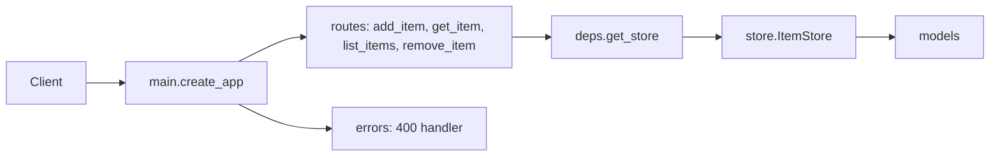
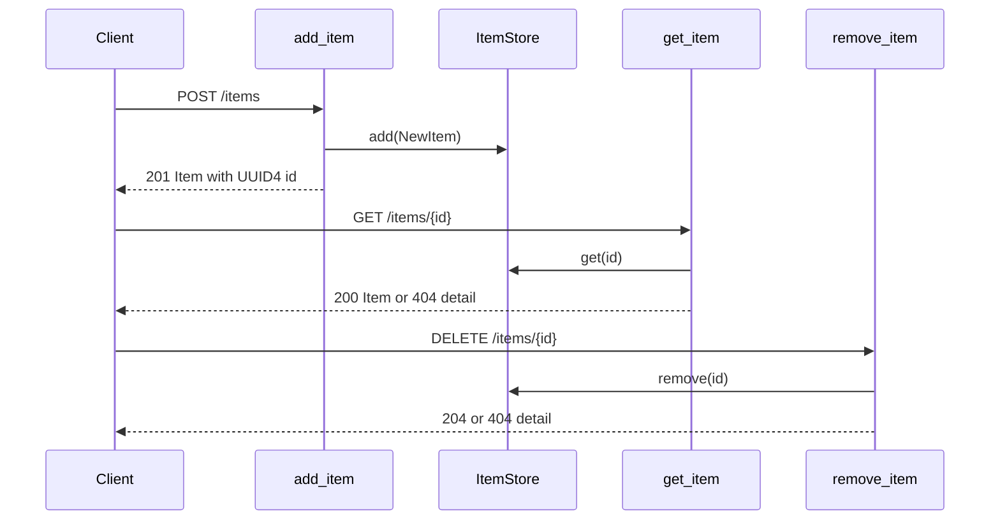

# Architecture
## Context
Shopping Cart API: REST service for one in-memory cart. No auth, no persistence, no external system.
## Technology stack
| Concern | Choice | Version | Source |
|---|---|---|---|
| Language | Python | 3.12 | PRD constraints |
| Framework | FastAPI (Pydantic v2), uvicorn | >=0.110, >=0.29 | PRD constraints |
| Data store | process memory (dict in ItemStore) | n/a | PRD non-goals |
| Test | pytest, httpx TestClient (uv, ruff, mypy) | latest | PRD, init |
## Architecture diagram

```text
Client --> [main.create_app] --> [routes: add_item | get_item | list_items | remove_item]
                |                    |--> [deps.get_store] --> [store.ItemStore] --> [models]
                '--> [errors: 400 handler]
```
## Code structure
```text
src/cart/
  main.py        # create_app(), app = create_app() (sprint 0)
  models.py      # NewItem, Item (sprint 0)
  store.py       # ItemStore, in-memory; remove added in sprint 1 (sprint 0)
  errors.py      # validation failure -> 400 {"detail"} (sprint 0)
  deps.py        # get_store (sprint 0)
  routes/        # __init__ includes every router; add_item, get_item, list_items (sprint 0), remove_item (sprint 1)
tests/           # conftest.py, test_smoke.py, test_<intent>.py (sprint 0)
```
## Containers and modules
One uvicorn process; routes depend on deps, store and models, never the reverse. Routes must not touch the store's dict; store must not know HTTP.
## Key flows

```text
1. Client -> add_item: POST /items    2. add_item -> ItemStore: add(NewItem)
3. add_item -> Client: 201 Item (400 {"detail"} if invalid, via errors)
4. Client -> get_item: GET /items/{id}   5. get_item -> ItemStore: get(id)
6. get_item -> Client: 200 Item, or 404 {"detail": "Item not found"}
7. Client -> remove_item: DELETE /items/{id}   8. remove_item -> ItemStore: remove(id)
9. remove_item -> Client: 204, or 404 {"detail": "Item not found"}
```
## Data
Item: `id` (UUID4 string), `name` (non-empty), `price` (>= 0), `quantity` (integer >= 1), kept in insertion order, lost on restart.
## Integrations
| Dependency | Kind | Contract | Stand-in | Live switch | ADR |
|---|---|---|---|---|---|
| HTTP API (4 routes; no external dependency) | internal | docs/contracts/*.yaml | none | none | ADR-0002 |
## Quality tactics
none: the PRD defines no NFR.
## Deployment
Local only: `make run`; no deployment, monitoring or rollback.
## Sprint history
| Sprint | Adds | Intents | ADRs |
|---|---|---|---|
| 0 | app factory, store, 400 handler, three routes | add-item, get-item, list-items | ADR-0001, ADR-0002 |
| 1 | DELETE /items/{id}, `ItemStore.remove` | remove-item | none |
## Decisions
- ADR-0001 item id is a UUID4 string (proposed, sprint 0); ADR-0002 errors are `{"detail"}`, validation is 400 (proposed, sprint 0).
- Store is a dict mutated by single assignment, read through a copy, no lock; state via `create_app()` and `app.state.store` (proposed at chart).
- `routes/__init__.py` includes every route module, so intents share no file (proposed at chart).
## Concerns
- pyproject.toml says `requires-python = ">=3.11"`, the PRD says Python 3.12; owner: cwijayasundaragmail.com (resolved) Require 3.12: add-item sets `requires-python = ">=3.12"`, decided by cwijayasundaragmail.com.
## Open questions
none
