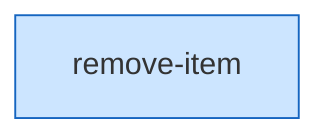

# Sprint 1 plan

<!-- Generated by `chart plan` from the intents' `depends:` lines. Do not edit: change an intent and regenerate. -->

1 intents, 1 engineer-day(s), 1 wave(s). Chart: missing. Intents in the same wave can be built in parallel.

Tasks and the suggested lanes per engineer: [implementation-plan.md](implementation-plan.md). Unassigned: remove-item (set `owner:` in each intent).

## Waves

| Wave | Intent | Depends on | Days | Owner | Status |
|---|---|---|---|---|---|
| 1 | remove-item | - | 1 | - | ready |

## Graph (text)

```text
remove-item ○ ready
```

Key: ✔ done, ▶ active, ○ ready, ✖ blocked. An arrow-free tree: each intent sits under its latest dependency.

## Graph (Mermaid)



## Next up

- chart-1 is missing: a person runs `/rig:approve chart-1` before anything can start
- `/rig:start remove-item`
