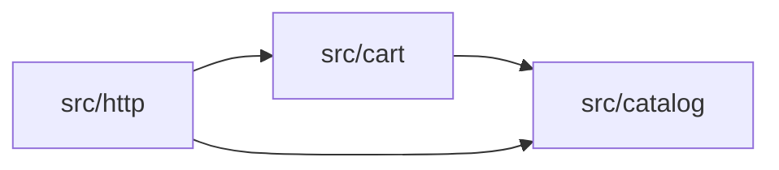
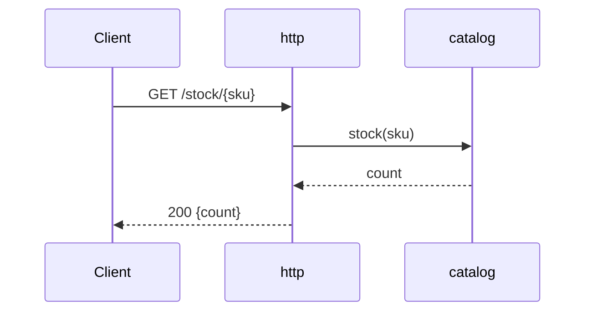

# Architecture

## Context

shop-app is a small Node.js HTTP service: customers put products in a cart, and the shop's stock limits what a cart can hold.

## Technology stack

| Concern | Choice | Version | Source |
|---|---|---|---|
| Language | JavaScript (ES modules) | Node 20 | repo |
| Framework | none (node:http) | | repo |
| Test | node:test | Node 20 | repo |

## Architecture diagram



```text
+-----------+      +-----------+
| src/http  |----->| src/cart  |
+-----------+      +-----------+
      |                  |
      |                  v
      |            +-------------+
      +----------->| src/catalog |
                   +-------------+
```

## Code structure

```
src/
  catalog/   # products and their stock count (sprint 1)
  cart/      # cart rules, reads stock from the catalog (sprint 1)
  http/      # handlers, one per endpoint (sprint 1)
test/        # node:test files, one per module
```

## Containers and modules

`src/catalog` gains a stock count; `src/cart` reads it; `src/http` exposes it. Dependencies point toward the catalog.

## Key flows



```text
Client          src/http              src/catalog
  |  GET /stock/{sku} |                     |
  |------------------>|    stock(sku)       |
  |                   |-------------------->|
  |                   |<--------------------|
  |  200 {count}      |       count         |
  |<------------------|                     |
```

## Quality tactics

| NFR | Target | Tactic | Where | Verified by |
|---|---|---|---|---|
| NFR-1 | every error names the SKU | every error message is built with the SKU in it | src/cart, src/http | unit test |

## Sprint history

| Sprint | Adds | Intents | ADRs |
|---|---|---|---|
| 1 | stock count, cart limit, stock endpoint | stock-model, stock-endpoint, cart-stock-limit | none |

## Decisions

none yet.

## Concerns

none

## Open questions

none
